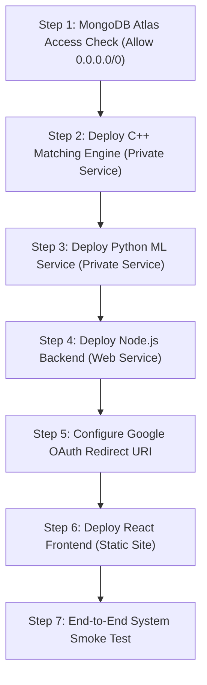

# UPRISE — Render Deployment Preparation Audit

**Target Release:** Commit `af768b293f9a7e5a3d920a5fafcff111882f596c` on branch `main`
**Repository Remote:** `https://github.com/Omkaar1234/AI_PaperTrading.git`
**Deployment Target:** Render Cloud Platform
**Audit Status:** Pre-Deployment Verification Complete — Zero Code or Git Mutations Performed

---

## 1. Baseline Git & Repository Verification

| Metric | Verified Value | Status |
| :--- | :--- | :---: |
| **Current Branch** | `main` | Pass |
| **Current HEAD SHA** | `af768b293f9a7e5a3d920a5fafcff111882f596c` | Pass |
| **Remote Tracking** | `origin/main` (Up to date with GitHub remote) | Pass |
| **Latest Pushed Commit** | `af768b2 Production release: UPRISE trading, ML prediction and notification system` | Pass |
| **Working-Tree State** | Local modifications preserved (`backend/server.js`, `frontend/src/App.css`, UI redesign files) | Preserved |
| **Local Research Assets** | Untracked research datasets, walk-forward logs, and scratch files preserved | Preserved |
| **Secrets Safety** | `.env` files untouched, uncommitted, and excluded from Docker contexts | Pass |

---

## 2. Component Container & Runtime Audit

The repository contains four distinct software components, each designed for independent containerization or static hosting:

```
PaperTrading (Repository Root)
├── backend/            --> Node.js 20 Express + WebSocket Orchestrator
├── matching-engine/    --> C++20 Low-Latency Order Book Engine (Raw TCP)
├── ml-service/         --> Python 3.11 Flask + Gunicorn Inference Engine
└── frontend/           --> React 18 Institutional Web Client
```

### Component Inspection Details

| Component | Base Image / Runtime | Exposed Ports | Health Check Path | Dockerfile Location | Build Context | Startup Command |
| :--- | :--- | :---: | :---: | :--- | :--- | :--- |
| **`backend`** | `node:20-slim` | `3001` | `GET /health` | `backend/Dockerfile` | `./backend` | `npm start` (`node server.js`) |
| **`matching-engine`** | `ubuntu:24.04` (Multi-stage CMake build) | `9000` (Raw TCP) | TCP Port Probe (Port 9000) | `matching-engine/Dockerfile` | `./matching-engine` | `./matching_engine 9000` |
| **`ml-service`** | `python:3.11-slim` | `5000` (HTTP) | `GET /health` | `ml-service/Dockerfile` | `./ml-service` | `gunicorn --bind 0.0.0.0:5000 --timeout 120 --workers 1 app:app` |
| **`frontend`** | `nginx:alpine` (or Static CDN) | `80` (or N/A) | `GET /` (`/index.html`) | `frontend/Dockerfile` | `./frontend` | `nginx -g "daemon off;"` |

### Detailed Docker Context & Ignore Evaluation

1. **`backend`**:
   - `backend/Dockerfile` uses `node:20-slim`, executes `npm ci --omit=dev`, and copies `server.js`, `services/`, and `src/`.
   - `backend/.dockerignore` correctly excludes `node_modules/`, `npm-debug.log*`, `.env`, and `.git/`.
2. **`matching-engine`**:
   - Multi-stage build with `ubuntu:24.04` (Stage 1: `g++`, `cmake`, `make`; Stage 2: `libstdc++6` minimal runtime).
   - Copies `CMakeLists.txt`, `include/`, and `src/` explicitly.
   - **Finding:** `matching-engine/.dockerignore` is currently absent. While the Dockerfile uses explicit `COPY` statements, adding a `.dockerignore` to ignore `build/` and `trades.log` is recommended to prevent transferring local build artifacts to the Docker daemon.
3. **`ml-service`**:
   - Uses `python:3.11-slim` with system package `libgomp1` (required for LightGBM C++ OpenMP threading on Debian).
   - Installs frozen dependencies from `requirements.txt`.
   - `ml-service/.dockerignore` explicitly ignores `venv/`, `__pycache__/`, `.env*`, `scratch/`, and heavy research directories (`research_21d/phase_5c/staging/`, `phase_5b/data/`, `phase_5d/`, `phase_5e/`, `phase_5f/`).
   - Copies root serving engines (`app.py`, `production_21d_service.py`, `features.py`, etc.), Phase 5A multi-signal cache (`news/cache/`), Phase 5A model (`hybrid21d_models.pkl`), and Phase 5B broad model (`broad21d_models.pkl`) with manifests.
4. **`frontend`**:
   - Multi-stage build (Stage 1: `node:20-slim`, `npm run build`; Stage 2: `nginx:alpine` with SPA rewrite configuration `try_files $uri $uri/ /index.html;`).
   - Accepts `ARG REACT_APP_API_URL` during build.

---

## 3. Render Service Type Mapping & Plan Requirements

Render provides distinct service types with specific networking rules:

```
+-----------------------------------------------------------------------------------+
|                               RENDER CLUSTER                                      |
|                                                                                   |
|  [ Public Internet ]                                                              |
|          |                                                                        |
|          | HTTPS (Port 443)                                                       |
|          v                                                                        |
|  +-----------------------------------+     +-----------------------------------+  |
|  | UPRISE Frontend                   |     | UPRISE Backend                    |  |
|  | Render Service: STATIC SITE       |     | Render Service: WEB SERVICE       |  |
|  | (Edge CDN, Zero-Sleep, Free)      |     | (Docker, Public HTTPS + WSS)      |  |
|  +-----------------------------------+     +-----------------------------------+  |
|                                                      |              |             |
|                                  Raw TCP (Port 9000) |              | HTTP (5000) |
|                     (Internal Mesh Network)          v              v             |
|                               +-----------------------------+ +----------------+  |
|                               | UPRISE Matching Engine      | | UPRISE ML      |  |
|                               | Render: PRIVATE SERVICE     | | Render:        |  |
|                               | (pserv, Starter Plan)       | | PRIVATE SERVICE|  |
|                               +-----------------------------+ +----------------+  |
+-----------------------------------------------------------------------------------+
                                                                      |
                                                                      | TLS (27017)
                                                                      v
                                                        +---------------------------+
                                                        | MongoDB Atlas             |
                                                        | External Cloud Database   |
                                                        +---------------------------+
```

### Component-by-Component Service Classification

#### 1. Backend (`uprise-backend`)
- **Assigned Type:** **Public Web Service** (`type: web`, runtime: `docker`).
- **Rationale:** Must accept incoming HTTPS REST requests from browsers and maintain bidirectional WebSocket connections (`/ws/market`) for live order book and quote streaming.

#### 2. C++ Matching Engine (`uprise-matching-engine`)
- **Assigned Type:** **Private Service** (`type: pserv`, runtime: `docker`).
- **Rationale:** Communicates strictly via **raw TCP on port 9000** (`net.Socket`). Render Public Web Services do not route raw TCP packets; only Render Private Services support non-HTTP TCP sockets across the internal mesh network.
- **Plan Requirement:** Private Services (`pserv`) require a paid compute plan (Render Starter tier at \$7/month). Render Free Tier does not support private internal services.

#### 3. ML Service (`uprise-ml-service`)
- **Assigned Type:** **Private Service** (`type: pserv`, runtime: `docker`).
- **Rationale:** The ML service is consumed exclusively by the backend orchestrator via internal HTTP POST calls (`/predict`, `/health`). Exposing it as a public web service is unnecessary, introduces external attack surface, and risks HTTP-to-HTTPS redirect drops on POST request bodies.
- **Plan Requirement:** Render Starter tier (\$7/month). 512 MB to 1 GB RAM allocation ensures stable in-memory loading of the LightGBM models and manifest lookups.

#### 4. Frontend (`uprise-frontend`)
- **Recommended Type:** **Static Site** (`type: static`, built from `frontend/`).
- **Alternative:** Web Service using `frontend/Dockerfile` + Nginx.
- **Rationale for Static Site:**
  1. **Instant Edge Delivery:** Served globally from Render's CDN.
  2. **Zero-Sleep Guarantee:** Unlike free Web Services, Static Sites never sleep or spin down after inactivity.
  3. **Zero Cost:** Static sites are 100% free on Render.
  4. **SPA Client Routing:** Fully supported using a simple Render Rewrite Rule (`/*` -> `/index.html`).

---

## 4. Service-to-Service Network & Protocol Tracing

A line-by-line inspection of the codebase reveals the following critical connection points and potential traps:

### A. Backend to Matching Engine
- **Code Reference:** `backend/server.js` (lines 42–43, 170–176).
- **Current Logic:**
  ```javascript
  const MATCHING_ENGINE_HOST = process.env.MATCHING_ENGINE_HOST || 'localhost';
  const MATCHING_ENGINE_PORT = process.env.MATCHING_ENGINE_PORT || 9000;
  this.client.connect(MATCHING_ENGINE_PORT, MATCHING_ENGINE_HOST, handleConnect);
  ```
- **Localhost / Railway Trap:** In local development, `MATCHING_ENGINE_HOST` defaults to `localhost`. On Railway, it was configured with a `.railway.internal` domain.
- **Render Resolution:** On Render, Private Services resolve by service name across the internal DNS. Setting:
  ```env
  MATCHING_ENGINE_HOST=uprise-matching-engine
  MATCHING_ENGINE_PORT=9000
  ```
  allows Node's `net.connect()` to resolve the internal hostname and establish the persistent TCP channel immediately.

### B. Backend to ML Service
- **Code Reference:** `backend/server.js` (line 41) and `backend/services/predictionService.js` (line 9).
- **Current Logic:**
  ```javascript
  const ML_SERVICE_URL = `http://${process.env.ML_HOST || 'localhost'}:${process.env.ML_PORT || 5000}`;
  ```
- **Trap Identified:** Both files hardcode `http://`. If the ML service were deployed as a public Render Web Service, Render would force an HTTPS redirect (301), which causes `axios.post()` to lose its request body or fail.
- **Render Resolution:** By deploying `ml-service` as an **Internal Private Service**, communication remains unencrypted plain HTTP over the internal mesh network. Setting:
  ```env
  ML_HOST=uprise-ml-service
  ML_PORT=5000
  ```
  resolves directly to `http://uprise-ml-service:5000`, matching the code without requiring any code edits.

### C. Frontend to Backend (HTTP & WebSocket)
- **Code Reference:** `frontend/src/constants.js` (line 1) and `frontend/src/hooks/useTradingData.js` (line 776).
- **Current Logic:**
  ```javascript
  // constants.js
  export const API_BASE_URL = process.env.REACT_APP_API_URL || 'http://localhost:3001';

  // useTradingData.js
  const wsBase = API_BASE_URL.replace(/^http/, 'ws');
  const wsUrl = `${wsBase}/ws/market?symbols=${symbolsQuery}`;
  new WebSocket(wsUrl);
  ```
- **Render Resolution:**
  - Build-time setting: `REACT_APP_API_URL=https://uprise-backend.onrender.com`.
  - HTTP REST endpoints automatically point to `https://uprise-backend.onrender.com`.
  - The regex `.replace(/^http/, 'ws')` correctly transforms `https://...` into `wss://uprise-backend.onrender.com/ws/market`, securing WebSocket traffic over TLS without modification.

### D. CORS & Cross-Origin Cookies
- **Code Reference:** `backend/server.js` (lines 46–101) and `backend/src/auth/authService.js` (lines 91–100).
- **Current Logic:**
  ```javascript
  // server.js
  const configuredOrigins = [process.env.CORS_ORIGIN, process.env.FRONTEND_URL]...
  const isProduction = process.env.NODE_ENV === 'production' || Boolean(process.env.RAILWAY_ENVIRONMENT);

  // authService.js
  function sessionCookieOptions() {
    const isProduction = process.env.NODE_ENV === 'production';
    return {
      httpOnly: true,
      secure: process.env.COOKIE_SECURE === 'true' || isProduction,
      sameSite: process.env.COOKIE_SAME_SITE || (isProduction ? 'none' : 'lax'),
      maxAge: Number(process.env.JWT_COOKIE_MAX_AGE_MS || 7 * 24 * 60 * 60 * 1000),
      path: '/'
    };
  }
  ```
- **Trap Identified:**
  1. If `NODE_ENV=production` is set, `allowedOrigins` strictly requires matching entries in `CORS_ORIGIN` or `FRONTEND_URL`. If either variable is omitted or omits the protocol (`https://`), cross-origin requests will be blocked by CORS.
  2. The `ptx_session` cookie requires `sameSite: 'none'` and `secure: true` because the frontend and backend reside on separate subdomains (`uprise-frontend.onrender.com` vs `uprise-backend.onrender.com`).
- **Render Resolution:** Set `NODE_ENV=production`, `FRONTEND_URL=https://uprise-frontend.onrender.com`, `CORS_ORIGIN=https://uprise-frontend.onrender.com`, `COOKIE_SECURE=true`, and `COOKIE_SAME_SITE=none`.

### E. Google OAuth 2.0 Flow
- **Code Reference:** `backend/src/auth/googleOAuth.js` (lines 3–9) and `backend/server.js` (lines 778–814).
- **Trap Identified:** `GOOGLE_CALLBACK_URL` is sent to Google's OAuth server. If it does not match Google Cloud Console's Authorized Redirect URIs down to the exact scheme, host, and path, Google returns `redirect_uri_mismatch` (Error 400).
- **Render Resolution:**
  - In Render backend environment: `GOOGLE_CALLBACK_URL=https://uprise-backend.onrender.com/api/auth/google/callback`.
  - In Google Cloud Console: Add `https://uprise-backend.onrender.com/api/auth/google/callback` to Authorized Redirect URIs.
  - Add `https://uprise-frontend.onrender.com` to Authorized JavaScript Origins.

---

## 5. Database & Persistence Architecture (MongoDB Atlas)

- **Configuration Code:** `backend/src/config/db.js` and `backend/src/services/persistenceService.js`.
- **Database Hosting:** External managed cloud cluster via **MongoDB Atlas** (never local container storage).
- **Storage Statelesness:** The Render backend container's filesystem is completely ephemeral. All stateful domain entities are persisted remotely:
  - Users & Wallets (`users` collection)
  - Orders (`orders` collection)
  - Execution Ledger (`trades` collection)
  - Portfolios & Positions (`positions` collection)
  - User Watchlists (`watchlists` collection)
  - Historical Market Cache (`marketdatacaches` collection)
  - Stock Metadata (`symbols` collection)
  - User In-App Notifications (`notifications` collection)
- **Atlas Network Access:** Because Render Web Services use dynamic IP addresses, the MongoDB Atlas Network Access list must allow `0.0.0.0/0` (Anywhere), secured with a strong database user password and TLS encryption (`mongodb+srv://`).

---

## 6. ML Service Production Artifact & Model Verification

All production ML artifacts required by `ml-service/Dockerfile` have been verified on disk with their SHA-256 hashes:

| Artifact / Dependency | File Path | File Size | SHA-256 (Prefix) | Verification Status |
| :--- | :--- | :---: | :---: | :---: |
| **Phase 5A Hybrid Model** | `ml-service/research_21d/models/hybrid21d_models.pkl` | 610,956 B | `acbb52c0639ba8eb...` | Verified Frozen |
| **Phase 5B Broad Model** | `ml-service/research_21d/phase_5b/models/broad21d_models.pkl` | 2,528,731 B | `e52a72d9d7804b9e...` | Verified Frozen |
| **Broad Feature Manifest** | `ml-service/research_21d/phase_5b/feature_manifest.json` | 14,872 B | `ba41f799acdf37aa...` | Verified |
| **Universe Manifest** | `ml-service/research_21d/phase_5b/universe_manifest.json` | 314,468 B | `1b52ec5ddde76683...` | Verified (2,254 Symbols) |
| **Multi-Signal News Cache** | `ml-service/news/cache/*` | 14 Files | ~933 KB each | Verified (7 Core Assets) |
| **Runtime Serving Service**| `ml-service/production_21d_service.py` | 32,474 B | `5ffe7359063f9be5...` | Verified |
| **Phase 5A Inference** | `ml-service/research_21d/dataset_21d.py` | 15,130 B | `a4f93c916ce12577...` | Verified |
| **Phase 5A Explanations**| `ml-service/research_21d/audit_4e3/explain_predictions.py` | 17,624 B | `d9590e59414fdb82...` | Verified |
| **Position Sizing** | `ml-service/research_21d/phase_4f/position_sizing.py` | 3,542 B | `3f1658fb8697703a...` | Verified |
| **Phase 5B Features** | `ml-service/research_21d/phase_5b/features_broad.py` | 11,755 B | `050b108535390b3d...` | Verified |
| **Phase 5B Explanations**| `ml-service/research_21d/phase_5b/explain_broad.py` | 7,383 B | `15d608e5c235f7a8...` | Verified |

### Safety Exclusions Confirmed
- **Candidate A2 / Phase 5C (`research_21d/phase_5c/`)**: Excluded from `ml-service/Dockerfile` and explicitly listed in `ml-service/.dockerignore`.
- **Heavy Research Datasets**: `research_21d/phase_5b/data/`, `phase_5d/`, `phase_5e/`, `phase_5f/`, and `scratch/` are excluded.
- **Gunicorn Timeout**: Set to `120` seconds in Dockerfile CMD, providing sufficient initialization margin for scikit-learn/LightGBM model deserialization.

---

## 7. C++ Matching Engine Protocol & Render Compatibility

- **Networking Architecture:** `matching-engine/src/network_server.cpp` (lines 41–46):
  ```cpp
  sockaddr_in server_addr{};
  server_addr.sin_family = AF_INET;
  server_addr.sin_addr.s_addr = INADDR_ANY; // Binds to 0.0.0.0
  server_addr.sin_port = htons(port_);      // Port 9000
  ```
- **Bind Verification:** The engine binds to `INADDR_ANY` (`0.0.0.0`), allowing it to accept TCP connections across Render's internal container network interface.
- **Health Checks on Render:** Render monitors Private Services by opening a TCP connection to the service port (`9000`). Because `network_server.cpp` listens with `SOMAXCONN` backlog, Render's TCP health checks will immediately succeed.
- **Port Flexibility:** `main.cpp` takes port via `argv[1]`, with a default fallback to `9000`. The Dockerfile runs `CMD ["./matching_engine", "9000"]`.
- **Internal Resolution:** The Node backend connects via `new net.Socket()`, which resolves standard DNS names provided by Render.

---

## 8. Exact Render Deployment Matrix

| Service Name | Render Service Type | Repo Directory | Build Config / Dockerfile | Start Command | Health Check | Internal / Public URL |
| :--- | :--- | :--- | :--- | :--- | :--- | :--- |
| **`uprise-backend`** | **Web Service** | `backend` | Docker (`backend/Dockerfile`) | `npm start` | `/health` (HTTP) | **Public:** `https://uprise-backend.onrender.com`<br>**Internal:** `uprise-backend:3001` |
| **`uprise-matching-engine`** | **Private Service** (`pserv`) | `matching-engine` | Docker (`matching-engine/Dockerfile`) | `./matching_engine 9000` | Port 9000 (TCP probe) | **Internal Only:** `uprise-matching-engine:9000` (Raw TCP) |
| **`uprise-ml-service`** | **Private Service** (`pserv`) | `ml-service` | Docker (`ml-service/Dockerfile`) | Gunicorn (`CMD` in Dockerfile) | `/health` (HTTP) | **Internal Only:** `http://uprise-ml-service:5000` |
| **`uprise-frontend`** | **Static Site** | `frontend` | Static (`npm install && npm run build`) | N/A (Static files served via CDN) | `/index.html` (HTTP 200) | **Public:** `https://uprise-frontend.onrender.com` |

---

## 9. Render Blueprint (`render.yaml`) Evaluation & Specification

A Render Blueprint (`render.yaml`) allows declaring all services as code.

### Feasibility Assessment
- **Pros:**
  1. Prevents configuration drift and manual typos across four services.
  2. Automatically links service hostnames and ports using `fromService`.
  3. Uses `sync: false` for all secrets (`JWT_SECRET`, `MONGODB_URI`, etc.), ensuring **no secrets are committed to the repository**.
- **Cons / Consideration:**
  - Private Services (`type: pserv`) require a paid plan (Starter tier, \$7/mo per private service = \$14/mo total). Creating a blueprint with `pserv` will prompt for billing confirmation in the Render dashboard.

### Proposed Production `render.yaml`

```yaml
services:
  # ========================================================
  # 1. C++ MATCHING ENGINE (Internal Low-Latency TCP Service)
  # ========================================================
  - type: pserv
    name: uprise-matching-engine
    runtime: docker
    plan: starter
    region: oregon
    dockerfilePath: ./matching-engine/Dockerfile
    dockerContext: ./matching-engine

  # ========================================================
  # 2. PYTHON ML SERVICE (Internal Inference HTTP Service)
  # ========================================================
  - type: pserv
    name: uprise-ml-service
    runtime: docker
    plan: starter
    region: oregon
    dockerfilePath: ./ml-service/Dockerfile
    dockerContext: ./ml-service
    envVars:
      - key: MODEL_TYPE
        value: lstm
      - key: SEQUENCE_LENGTH
        value: "60"
      - key: PREDICTION_THRESHOLD
        value: "0.02"
      - key: YAHOO_FINANCE_ENABLED
        value: "true"
      - key: ALPHA_VANTAGE_API_KEY
        sync: false

  # ========================================================
  # 3. NODE.JS BACKEND (Public API & WebSocket Orchestrator)
  # ========================================================
  - type: web
    name: uprise-backend
    runtime: docker
    plan: starter
    region: oregon
    dockerfilePath: ./backend/Dockerfile
    dockerContext: ./backend
    healthCheckPath: /health
    envVars:
      - key: NODE_ENV
        value: production
      - key: BACKEND_PORT
        value: "3001"
      - key: BACKEND_HOST
        value: "0.0.0.0"
      - key: FRONTEND_URL
        value: https://uprise-frontend.onrender.com
      - key: CORS_ORIGIN
        value: https://uprise-frontend.onrender.com
      - key: COOKIE_SECURE
        value: "true"
      - key: COOKIE_SAME_SITE
        value: none
      - key: MATCHING_ENGINE_HOST
        fromService:
          type: pserv
          name: uprise-matching-engine
          property: host
      - key: MATCHING_ENGINE_PORT
        fromService:
          type: pserv
          name: uprise-matching-engine
          property: port
      - key: ML_HOST
        fromService:
          type: pserv
          name: uprise-ml-service
          property: host
      - key: ML_PORT
        fromService:
          type: pserv
          name: uprise-ml-service
          property: port
      - key: MONGODB_ENABLED
        value: "true"
      - key: MONGODB_DB
        value: paper_trading
      - key: MONGODB_CONNECT_TIMEOUT_MS
        value: "10000"
      - key: DEFAULT_QUANTITY
        value: "10"
      - key: MIN_ORDER_SIZE
        value: "1"
      - key: MAX_ORDER_SIZE
        value: "10000"
      - key: PRICE_PRECISION
        value: "2"
      # Secrets prompted securely in Render Dashboard (sync: false)
      - key: JWT_SECRET
        sync: false
      - key: MONGODB_URI
        sync: false
      - key: GOOGLE_CLIENT_ID
        sync: false
      - key: GOOGLE_CLIENT_SECRET
        sync: false
      - key: GOOGLE_CALLBACK_URL
        value: https://uprise-backend.onrender.com/api/auth/google/callback

  # ========================================================
  # 4. REACT FRONTEND (Global CDN Static Site)
  # ========================================================
  - type: web
    name: uprise-frontend
    runtime: static
    plan: free
    region: oregon
    buildCommand: cd frontend && npm install && npm run build
    staticPublishPath: ./frontend/build
    routes:
      - type: rewrite
        source: /*
        destination: /index.html
    envVars:
      - key: REACT_APP_API_URL
        value: https://uprise-backend.onrender.com
```

---

## 10. Deployment Blockers vs. Optional Improvements

### Deployment Blockers (Must Be Addressed for Live Operation)
1. **Render Service Type for Matching Engine**: The matching engine **cannot** be deployed as a public Web Service on Render due to raw TCP requirements. It must be created as a **Private Service** (`pserv`) on a paid Starter plan.
2. **MongoDB Atlas IP Whitelisting**: MongoDB Atlas Network Access must have `0.0.0.0/0` added, as Render instances communicate from dynamic outbound cloud IPs.
3. **Frontend Build-Time API URL**: `REACT_APP_API_URL` must be set in the frontend service environment **before** running the build command so Create React App bakes the live backend URL into the production bundle.
4. **Google Cloud OAuth Redirect URI**: `https://<backend-service>.onrender.com/api/auth/google/callback` must be added to Authorized Redirect URIs in Google Cloud Console Credentials.
5. **CORS & Cookie Alignment**: `FRONTEND_URL` and `CORS_ORIGIN` must match the actual frontend Render domain exactly (including `https://`), and `COOKIE_SAME_SITE=none` + `COOKIE_SECURE=true` must be set for cross-origin session authentication.

### Optional Improvements (Non-Blockers)
1. Add `matching-engine/.dockerignore` to exclude local `build/` and `trades.log`.
2. Add `const PORT = process.env.PORT || process.env.BACKEND_PORT || 3001;` fallback in `backend/server.js` for non-Docker environments.
3. Add an automated keep-alive ping (e.g. Cron job or Uptime monitor) to `GET /health` if running Web Services on plans with sleep behavior.

---

## 11. Step-by-Step Deployment Sequence



### Execution Steps

1. **Step 1: Verify MongoDB Atlas Connectivity**
   - Log into MongoDB Atlas dashboard.
   - Go to **Network Access** > **IP Access List**.
   - Verify `0.0.0.0/0` is allowed (or add it with a description `Render Cloud Access`).
2. **Step 2: Deploy Matching Engine on Render**
   - In Render Dashboard: **New +** > **Private Service**.
   - Connect repository `https://github.com/Omkaar1234/AI_PaperTrading`.
   - Name: `uprise-matching-engine`.
   - Root Directory: `matching-engine`.
   - Runtime: `Docker`.
   - Dockerfile Path: `Dockerfile` (or `./matching-engine/Dockerfile` if root is repo).
   - Plan: `Starter`.
   - Click **Create Private Service**. Verify build passes and TCP port 9000 is open.
3. **Step 3: Deploy ML Service on Render**
   - In Render Dashboard: **New +** > **Private Service**.
   - Connect repository.
   - Name: `uprise-ml-service`.
   - Root Directory: `ml-service`.
   - Runtime: `Docker`.
   - Plan: `Starter`.
   - Set environment variables (see list below).
   - Click **Create Private Service**. Verify build passes and `GET /health` returns `healthy`.
4. **Step 4: Deploy Backend Web Service on Render**
   - In Render Dashboard: **New +** > **Web Service**.
   - Connect repository.
   - Name: `uprise-backend`.
   - Root Directory: `backend`.
   - Runtime: `Docker`.
   - Health Check Path: `/health`.
   - Set all required environment variables (including secrets and internal hostnames).
   - Click **Create Web Service**. Verify build passes and public `https://uprise-backend.onrender.com/health` returns `healthy`.
5. **Step 5: Update Google Cloud Console Credentials**
   - In Google Cloud Console > APIs & Services > Credentials:
   - Select your OAuth 2.0 Web Client.
   - Under **Authorized redirect URIs**, add:
     `https://uprise-backend.onrender.com/api/auth/google/callback`
   - Under **Authorized JavaScript origins**, add:
     `https://uprise-frontend.onrender.com`
   - Save changes.
6. **Step 6: Deploy Frontend Static Site on Render**
   - In Render Dashboard: **New +** > **Static Site**.
   - Connect repository.
   - Name: `uprise-frontend`.
   - Root Directory: `frontend`.
   - Build Command: `npm install && npm run build`.
   - Publish Directory: `build`.
   - Under **Environment Variables**, add:
     `REACT_APP_API_URL=https://uprise-backend.onrender.com`
   - Under **Redirects/Rewrites**, add:
     - Source: `/*`
     - Destination: `/index.html`
     - Action: `Rewrite`
   - Click **Create Static Site**.
7. **Step 7: Run End-to-End System Smoke Test**
   - Navigate to `https://uprise-frontend.onrender.com`.
   - Verify:
     - [ ] Landing page loads with 0 errors.
     - [ ] Register new test user with initial balance chip selection.
     - [ ] Google OAuth login flow completes and lands on `/dashboard`.
     - [ ] Live market quotes and `/ws/market` WebSocket stream connect.
     - [ ] Order placement matches via C++ engine; trade receipt created.
     - [ ] Positions, orders, and portfolio cards update reactively.
     - [ ] ML forecast generates valid prediction without jargon.
     - [ ] Notification dropdown logs trade execution alert.

---

## 12. Manual Environment Variable Configuration Checklist

### Service 1: `uprise-backend` (Render Web Service)

| Environment Variable Name | Type | Purpose | Example / Required Format |
| :--- | :---: | :--- | :--- |
| `NODE_ENV` | Config | Production flag | `production` |
| `BACKEND_PORT` | Config | Local listen port inside container | `3001` |
| `BACKEND_HOST` | Config | Interface binding | `0.0.0.0` |
| `FRONTEND_URL` | Config | URL of the frontend | `https://uprise-frontend.onrender.com` |
| `CORS_ORIGIN` | Config | Allowed origins for CORS | `https://uprise-frontend.onrender.com` |
| `COOKIE_SECURE` | Config | HTTPS cookie flag | `true` |
| `COOKIE_SAME_SITE` | Config | Cross-site cookie attribute | `none` |
| `MATCHING_ENGINE_HOST` | Network | Internal hostname of matching engine | `uprise-matching-engine` |
| `MATCHING_ENGINE_PORT` | Network | Port of matching engine | `9000` |
| `ML_HOST` | Network | Internal hostname of ML service | `uprise-ml-service` |
| `ML_PORT` | Network | Port of ML service | `5000` |
| `MONGODB_ENABLED` | Config | Enable persistence layer | `true` |
| `MONGODB_DB` | Config | MongoDB database name | `paper_trading` |
| `MONGODB_CONNECT_TIMEOUT_MS` | Config | Connection timeout | `10000` |
| `DEFAULT_QUANTITY` | Trading | Default order quantity | `10` |
| `MIN_ORDER_SIZE` | Trading | Minimum order constraint | `1` |
| `MAX_ORDER_SIZE` | Trading | Maximum order constraint | `10000` |
| `PRICE_PRECISION` | Trading | Decimal precision | `2` |
| `JWT_SECRET` | **SECRET** | Session token signing secret | *(Existing value from your `.env`)* |
| `MONGODB_URI` | **SECRET** | MongoDB Atlas connection string | *(Existing value from your `.env`)* |
| `GOOGLE_CLIENT_ID` | Secret/ID | Google OAuth Client ID | *(Existing value from your `.env`)* |
| `GOOGLE_CLIENT_SECRET` | **SECRET** | Google OAuth Client Secret | *(Existing value from your `.env`)* |
| `GOOGLE_CALLBACK_URL` | Config | Google redirect destination | `https://uprise-backend.onrender.com/api/auth/google/callback` |

---

### Service 2: `uprise-ml-service` (Render Private Service)

| Environment Variable Name | Type | Purpose | Example / Required Format |
| :--- | :---: | :--- | :--- |
| `MODEL_TYPE` | Config | Default fallback architecture | `lstm` |
| `SEQUENCE_LENGTH` | Config | Feature lookback window | `60` |
| `PREDICTION_THRESHOLD` | Config | Threshold gating | `0.02` |
| `YAHOO_FINANCE_ENABLED` | Config | Live quote fallback toggle | `true` |
| `ALPHA_VANTAGE_API_KEY` | **SECRET** | Stock data provider API key | *(Existing value from your `.env`)* |

---

### Service 3: `uprise-matching-engine` (Render Private Service)

| Environment Variable Name | Type | Purpose | Example / Required Format |
| :--- | :---: | :--- | :--- |
| *(None strictly required)* | — | Port `9000` is passed via container `CMD` | Defaults to port `9000` |

---

### Service 4: `uprise-frontend` (Render Static Site)

| Environment Variable Name | Type | Purpose | Example / Required Format |
| :--- | :---: | :--- | :--- |
| `REACT_APP_API_URL` | Build-time | Public backend URL baked into React build | `https://uprise-backend.onrender.com` |

---
*Audit Completed — All inspection tasks performed safely and non-destructively. Ready for deployment execution upon confirmation.*
